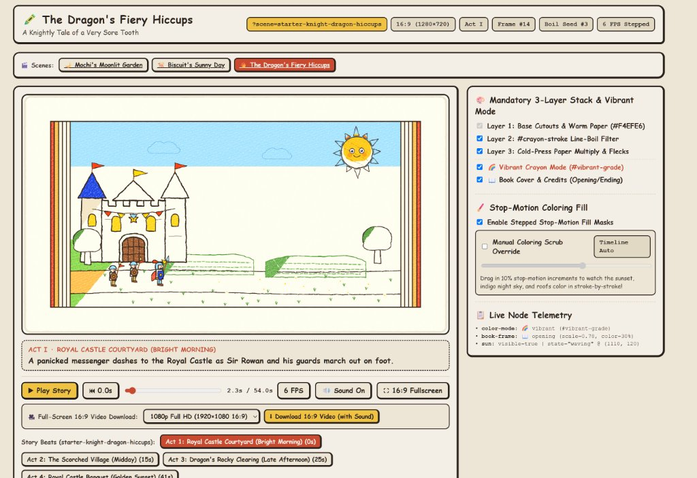
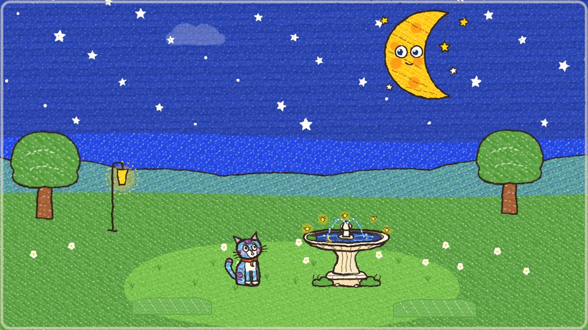
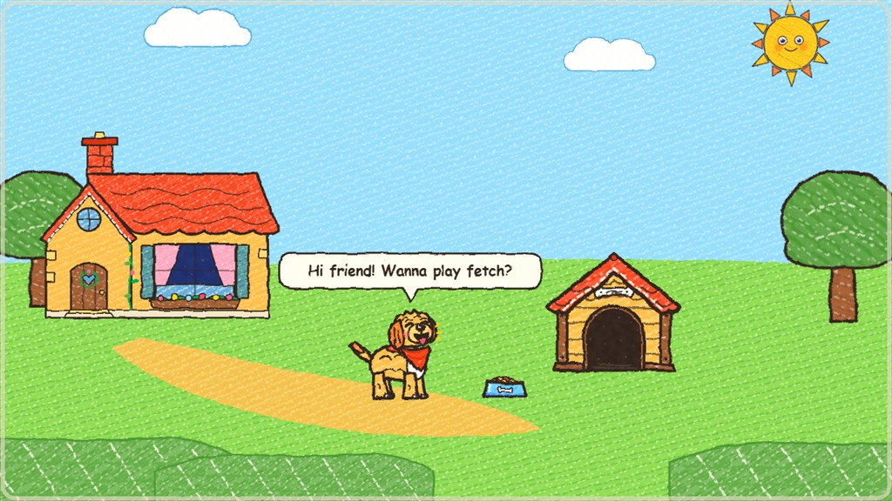
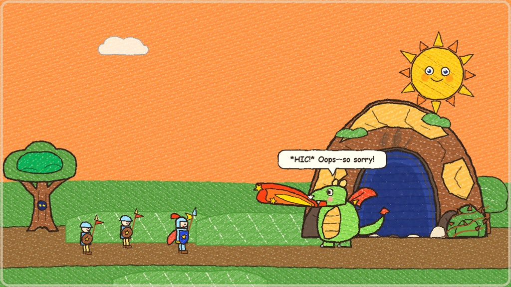

# Animated Picture Book Studio

<p align="center">
  
</p>

> Create animated storybook videos in **two distinct visual styles** — **Picture-Book Crayon** (`6 FPS` wax-crayon/oil-pastel stop-motion) or **Classic 1970s–80s Hand-Drawn Cel Animation** (`12 FPS` Xerox ink-and-paint & painted watercolor/gouache) — from a single prompt, with custom photo characters, expressive voiceovers, music, live preview, and MP4 export.

---

## Example Videos

All three videos below were generated on **Gemini 4 Neon (High)** **simultaneously in parallel** (~27 min total wall-clock time across 3 isolated `picture-book-director` agents, from prompt to verified 1080p MP4 — all individual generation times below are on **Gemini 4 Neon (High)**) and are bundled directly inside `engine/` (scenes, characters, props, music, SFX & voiceovers) so you can play or remix them immediately in the Studio:

| Starter Prompt 1: Moonlit Garden Cat | Starter Prompt 2: Photo-to-Character Dog | Starter Prompt 3: Dragon's Fiery Hiccups |
| :---: | :---: | :---: |
| <a href="https://drive.google.com/file/d/1VvgBGx_cFphVrS_iwxea7EHuWmIVBpsQ/view?usp=sharing" target="_blank" rel="noopener noreferrer"></a> | <a href="https://drive.google.com/file/d/1mNw0_vNDS-cA7FGQaB67LrtTppG41z2A/view?usp=sharing" target="_blank" rel="noopener noreferrer"></a> | <a href="https://drive.google.com/file/d/1-9GhbInbPeWPJCewOjXO9IT0aMnPn2Mc/view?usp=sharing" target="_blank" rel="noopener noreferrer"></a> |
| <a href="https://drive.google.com/file/d/1VvgBGx_cFphVrS_iwxea7EHuWmIVBpsQ/view?usp=sharing" target="_blank" rel="noopener noreferrer"><strong>Watch: Mochi's Moonlit Garden</strong></a><br><strong>Generation time:</strong> `25m 30s` (30s video)<br><strong>Requirements:</strong> **Gemini TTS API key** for narration & cat meows. | <a href="https://drive.google.com/file/d/1mNw0_vNDS-cA7FGQaB67LrtTppG41z2A/view?usp=sharing" target="_blank" rel="noopener noreferrer"><strong>Watch: Biscuit's Sunny Day</strong></a><br><strong>Generation time:</strong> `26m 32s` (38s video)<br><strong>Requirements:</strong> **Reference pet photo + Gemini TTS API key** for narrator & puppy voiceover. | <a href="https://drive.google.com/file/d/1-9GhbInbPeWPJCewOjXO9IT0aMnPn2Mc/view?usp=sharing" target="_blank" rel="noopener noreferrer"><strong>Watch: The Dragon's Fiery Hiccups</strong></a><br><strong>Generation time:</strong> `22m 24s` (54s video)<br><strong>Requirements:</strong> **No API key required** (100% text/speech bubbles, zero narration). |

For more example videos, check out the shared **[Animated Picture Book Studio Examples](https://drive.google.com/drive/folders/1-fXpca2eCJVwiKnQaO5K-KjcpFlC4a_5)** folder.

---

## Installation

### Option 1: One-Command Install (Antigravity CLI)
```bash
agy plugin install github.com/alif1383/animated_picture_book_studio
```
Plugins installed via the CLI automatically sync to the **Antigravity App**.

### Option 2: Manual Install (Antigravity App / IDE)
Clone or download this repository into your global plugins folder:
```bash
git clone https://github.com/alif1383/animated_picture_book_studio.git ~/.gemini/config/plugins/animated-picture-book-studio
```
*(On Windows PowerShell, clone into `$HOME\.gemini\config\plugins\animated-picture-book-studio`.)*

---

## Before You Begin: Optional Voiceover & Narration Setup (API Key)

You can create complete animated picture-book videos using **text/speech bubbles, music, and sound effects with no API key at all**.

If you also want **expressive voiceovers, multi-character dialogue, or fully custom narrations**, the plugin uses Google AI Studio's Generate Speech (Gemini TTS) API, which requires a **Google AI Studio API key**:

- **Free to start ($0, no credit card required):** A free Google AI Studio key unlocks all **30 studio voices**, **40 character/narrator presets**, acting direction prompts, accents, expressive vocal tags (`<laugh>`, `<sigh>`, `<gasp>`), and multi-speaker dialogue within free daily quotas.
- **Very low cost if you upgrade to Paid Tier:** Enabling billing unlocks higher daily quotas and **fully custom prompted voice design** (`voice-design`). Pricing is roughly **$0.54–$0.81 per full hour** of generated audio — meaning a typical 30–60 second picture-book video costs **around 1–2 cents**.

### How to Get & Save Your API Key (~15 seconds)
1. Open **[Google AI Studio API Keys](https://aistudio.google.com/apikey)** *(or open the [Speech Playground](https://aistudio.google.com/generate-speech) and click **Get API key** in the sidebar)*.
2. Sign in with your Google account and click **Create API key**.
3. Copy the key (starts with `AIzaSy...`) and either:
   - **Paste it in chat** when the agent asks for it (it saves the key for you automatically), **or**
   - **Save it once via CLI**:
     ```bash
     agy-node ~/.gemini/config/plugins/animated-picture-book-studio/skills/picture-book-voiceover/scripts/generate_audio.mjs set-key "<YOUR_API_KEY>"
     ```
   *(The key is saved locally in `~/.gemini/config/animated_picture_book_studio/config.json` and persists across all future Antigravity sessions. You can also pass it via the `GEMINI_API_KEY` environment variable.)*

---

## Overview

The **Animated Picture Book Studio** is a **100% standalone, zero-dependency** Antigravity plugin that bundles the complete Picture-Book Crayon Video Engine inside `<plugin-root>/engine/` (`~/.gemini/config/plugins/animated-picture-book-studio/engine/`), including pre-bundled pure-JS compilers and libraries (`vendor/typescript`, `vendor/mp4-muxer`, `vendor/vitest-shim`, `vendor/isomorphic-git`) and zero-dependency CLI tools (`scripts/studio-cli.mjs`, `scripts/vcs.mjs`, `scripts/generate_audio.mjs`, `scripts/analyze_reference_photo.mjs`).

It works out-of-the-box on **any machine with only Antigravity installed** (`agy-node`)—no external `node`, `npm`, `pnpm`, `git`, or `python` installation is required. You can scaffold the bundled engine into any active `<workspace>` (or run it in-place) using `agy-node "<plugin-root>/scripts/ensure_engine.mjs"`. It provides skills, agents, rules, and the full engine so you can ask Antigravity to:

- **Create animated videos in two distinct styles** *(if you don't specify a style in your prompt, the agent will ask you which one you want right after checking your voiceover API key)*:
  1. **Picture-Book Crayon Style (`artStyle: 'crayon'`, `6 FPS`, Studio route `/`)** — Warm wax-crayon & oil-pastel stop-motion on heavy cold-press watercolor paper, complete with an automatic **Storybook Cover Opening & Ending/Credits Book-Frame (`bookFrame`)** where a hardcover picture book opens to a `0%` charcoal sketch, progressively colors in `0% → 100%` as the camera zooms in, and un-colors back to a sketch before closing with `"The End ★"`.
  2. **Classic Hand-Drawn Animation Style (`artStyle: 'classic_cel'`, `12 FPS` on twos, Studio route `/classic/...`)** — Authentic 1970s–1980s theatrical Disney cel animation inspired by ***Robin Hood* (1973)** and ***Mickey's Christmas Carol* (1983)**: raw electrostatic Xerox graphite toner outlines + flat matte analog cel paint characters (NO modern digital gradients or neon glow halos) hovering over dappled watercolor/gouache illustration-board backgrounds with subtle rostrum cel depth, organic `12 FPS` ("on twos") motion exported in a `24 FPS` film container, tangible 35mm Eastmancolor celluloid film grain & optical vignette, and classic **Theatrical Iris/Fade Opening & `"The End"` Closing Cards (`theatricalFrame`)**. Includes a full Classic Cel showcase of *Mochi's Moonlit Garden* at **`http://localhost:5173/classic/mochi`** (`/classic/classic-moonlit-cat`).
- **Model assets after photos** — Turn user-provided photos into either hand-crafted 2D wax-crayon cutout SVG assets (`src/assets/`) or authentic Xerox flat-cel & dappled-gouache SVG assets (`src/assets/classicCel/`).
- **Add and generate audio** — Sync built-in procedural sound effects, attach user-provided audio files, or generate narration and custom WAV sound effects at precise timestamps.
- **Preview live** — Spin up the bundled studio dev server (`agy-node scripts/studio-cli.mjs dev`) and switch effortlessly between **`/`** (Picture-Book Crayon Studio) and **`/classic/mochi`** (Classic 1970s–80s Hand-Drawn Cel Studio), with playback controls, live audio/voiceover playback, and layer toggles.
- **Export MP4 directly via CLI** — Run `agy-node scripts/studio-cli.mjs export --scene <id> --resolution 1080p` (with optional `--style classic_cel|crayon`) to export the `.mp4` in headless mode without needing to open a visible browser tab or click buttons, then launch the dev server so you can inspect the live site as well.

### Visual Modes: Classic vs. Vibrant Crayon Mode (`crayon` Style)

In Picture-Book Crayon style, you can preview and export any video in either **Classic (non-vibrant)** or **Vibrant** mode (just ask in your prompt, toggle the **Vibrant Crayon Mode** checkbox in the Studio UI, pass `?vibrant=1|0` in the URL, or pass `--vibrant 1|0` to `studio-cli.mjs export`):

- **Classic Mode (Non-Vibrant, default):** A warm, muted, vintage picture-book look with stronger cold-press watercolor paper grain and chalky dry-crayon texture showing through the pigment — ideal for cozy bedtime stories and moonlit scenes.
- **Vibrant Mode (`--vibrant 1`):** Boosts crayon pigment saturation (`1.42×`) and contrast, fills strokes more densely, and softens the paper overlay so blues, greens, reds, and yellows pop off the page — ideal for bright daytime adventures and upbeat comedies.

---

## Plugin Contents

```
<plugin-root>/
├── plugin.json                              # Plugin manifest
├── README.md                                # This file
├── assets/
│   └── logo.svg                             # Plugin logo
├── engine/                                  # Complete bundled Picture-Book Studio engine
│   ├── src/                                 # Engine, scenes, characters, props, buildings, audio, UI
│   ├── vendor/                              # Pre-bundled pure-JS runtime dependencies (zero npm needed)
│   │   ├── typescript/                      # TypeScript compiler (tsc) + standard lib*.d.ts
│   │   ├── mp4-muxer/                       # Pure-JS H.264/AAC MP4 muxer
│   │   ├── vitest-shim/                     # Zero-dependency test runner shim
│   │   └── isomorphic-git/                  # Pure-JS .git repository & commit engine
│   ├── scripts/
│   │   ├── studio-cli.mjs                   # Zero-dep CLI: typecheck, test, build, dev (:5173)
│   │   ├── ts-loader-hooks.mjs              # Node module.register TypeScript & vendor loader
│   │   ├── vcs.mjs                          # Auto-detects native git vs bundled isomorphic-git
│   │   ├── generate_audio.mjs               # Zero-Python WAV SFX & TTS audio generator
│   │   └── analyze_reference_photo.mjs      # Zero-Python PNG color cluster & TOKENS mapper
│   ├── docs/                                # ARCHITECTURE.md & STYLE_GUIDE.md
│   ├── tests/                               # Unit & integration test suites
│   ├── public/                              # Static assets & public/audio/
│   ├── exports/                             # Gitignored target directory for exported .mp4 videos (auto-created on export)
│   ├── index.html                           # Studio entry HTML
│   ├── package.json                         # Scripts routed to scripts/studio-cli.mjs
│   └── tsconfig.json                        # Strict TypeScript config mapped to vendor/
├── scripts/
│   ├── bootstrap-node.cmd                   # Windows agy-node shim bootstrapper
│   ├── bootstrap-node.sh                    # macOS/Linux agy-node shim bootstrapper
│   ├── ensure_engine.mjs                    # Scaffolds/syncs bundled engine via agy-node
│   └── vcs.mjs                              # Standalone VCS helper (git or isomorphic-git)
├── rules/
│   └── AGENTS.md                            # Always-on routing rules & non-negotiable guardrails
├── agents/
│   └── picture-book-director.md             # Main turnkey orchestrator & export agent (spins up parallel subagents)
└── skills/                                  # 8 modular domain skills (2 symmetric visual style pairs + 4 shared skills)
    ├── picture-book-script/
    │   └── SKILL.md                         # Style-aware story craft, continuity/scale staging & character voice sheets
    ├── picture-book-animation/
    │   ├── SKILL.md                         # Picture-Book Crayon scene design (`crayon`, 6 FPS, terrain, `bookFrame`)
    │   └── references/
    │       └── catalog-and-schema.md        # Full asset catalog & TypeScript schema
    ├── photo-to-crayon-asset/
    │   ├── SKILL.md                         # Picture-Book Crayon photo-to-SVG asset workflow & 6 FPS rigging (`src/assets/`)
    │   └── scripts/
    │       └── analyze_reference_photo.mjs  # Zero-dep Node photo analysis utility
    ├── classic-animation/
    │   └── SKILL.md                         # Classic 1970s–80s Hand-Drawn Cel scene design (`classic_cel`, 12 FPS, gouache, `theatricalFrame`)
    ├── classic-cel-asset/
    │   └── SKILL.md                         # Classic Cel 2-tone ink-and-paint asset pipeline & 12 FPS rigging (`src/assets/classicCel/`)
    ├── picture-book-voiceover/
    │   ├── SKILL.md                         # Style-aware Google AI Studio Generate Speech (Gemini TTS) voiceover guide
    │   ├── references/
    │   │   └── voice-catalog.md             # All 30 Gemini voices & 40 character/narrator presets
    │   └── scripts/
    │       └── generate_audio.mjs           # Zero-dep Node Gemini TTS, dialogue, voice-design & WAV SFX CLI
    ├── picture-book-audio/
    │   ├── SKILL.md                         # Style-aware SFX, dynamic BGM & `audioClips` sync guide
    │   ├── references/
    │   │   └── audio-catalog.md             # Master Audio & Sound Effects Catalog
    │   └── scripts/
    │       └── generate_audio.mjs           # Zero-dep Node WAV SFX & clip inspection CLI
    └── picture-book-studio-export/
        └── SKILL.md                         # Dev server, headless MP4 export (`--style`, 24/30 FPS) & asset promotion runbook
```

---

## Skills (8 Domain Skills)

### ✍️ `picture-book-script` *(Shared — Both Styles)*
Story and scriptwriting skill invoked automatically whenever the user's prompt is brief or lacks detail:
- Locks the **Animation Style (`crayon` | `classic_cel`)** and crafts classic 3–5 act arcs sized around `bookFrame` (`3.5s` open/close, `6 FPS`) or `theatricalFrame` (`3.0s` iris/fade + gold-serif title cards, `12 FPS`)
- Bakes in chronological day/night continuity, location-driven background changes, brisk exit cuts, in-scene object/companion permanence, and proportional scale
- Defines a complete **Character Voice Casting & Sound Direction Sheet** (`docs/VOICE_CATALOG.md`, `--style` acting prompts, inline vocal tags) and **Dynamic BGM & SFX Cue Sheet** (`docs/AUDIO_CATALOG.md`)
- Outputs a **Parallel-Ready Production Script Blueprint** with exact file paths and IDs so code, asset, SFX/BGM, and voiceover subagents can immediately execute side-by-side

### 🖍️ `picture-book-animation` *(Picture-Book Crayon Style — `artStyle: 'crayon'`)*
Complete guide to designing, choreographing, and editing scenes in **Picture-Book Crayon Style** (`6 FPS`):
- Core visual philosophy (wax crayon, oil pastel, cold-press watercolor paper aesthetic) and 3-layer crayon render pipeline
- Mandatory Two-Tier Terrain Coloring, Story Continuity, Location Backgrounds, Brisk Empty-Stage Cuts, and Proportional Scale
- **Storybook Cover Opening & Ending/Credits Book-Frame (`bookFrame`)**: Default `3.5s` opening cover & `0% -> 100%` color-in zoom (`0.68 -> 1.0`), full-bleed middle story, and final `3.5s` `100% -> 0%` color-out zoom-out & closing credits card
- `SceneDefinition` schema, built-in characters, buildings, props, 22+ crayon fill patterns, Vibrant Crayon Mode, and 6 FPS stop-motion rules

### 📷 `photo-to-crayon-asset` *(Picture-Book Crayon Style — `src/assets/`)*
Step-by-step workflow for turning user photos (or specs) into hand-crafted 2D wax-crayon cutout SVG assets:
- Visual inspection and automated palette mapping via `analyze_reference_photo.mjs`
- SVG cutout decomposition (`crayonPath`, `TOKENS.patterns.*`), multi-state rigging (`+X` forward walking profile, `CHARACTER_SPEECH_ANCHORS`, stepped `6 FPS` animated speaking mouths), and proportional local SVG sizing
- File-isolated authoring for parallel subagents + registration checklist

### 🎞️ `classic-animation` *(Classic Hand-Drawn Animation Style — `artStyle: 'classic_cel'`, `/classic/...`)*
Complete guide to designing, choreographing, and editing authentic **1970s–1980s Classic Hand-Drawn Cel** scenes inspired by *Robin Hood* (1973) & *Mickey's Christmas Carol* (1983):
- Dappled, loose watercolor/gouache illustration-board backgrounds (`#gouache-wash`, `gouacheDabWash`, `#bg-board-texture`) with sparse loose hand-inked foliage/grass/wood ticks
- Raw electrostatic Xerox graphite toner outlines (`#xerox-ink`, `xeroxSketchStroke`) + flat matte analog cel paint foreground characters separated by subtle rostrum cel depth (`#cel-drop-shadow`), Eastmancolor 35mm print grading (`#cel-grade`), and tangible animated 35mm celluloid film grain (`#layer-3-film-composite`)
- **Theatrical Iris/Fade Opening & `"The End"` Closing Cards (`theatricalFrame`)** and organic **`12 FPS` ("on twos")** motion exported inside a **`24 FPS`** MP4 film container
- Dedicated `/classic` / `/classic/mochi` / `/classic/<sceneId>` Studio route (`src/scenes/classicMoonlitCat.ts`)

### 🖌️ `classic-cel-asset` *(Classic Hand-Drawn Animation Style — `src/assets/classicCel/`)*
Step-by-step workflow for creating authentic 1970s–1980s Xerox flat-cel characters and painted watercolor/gouache props & architecture (from user photos or story specs):
- Flat opaque matte analog cel paint (earthy 1970s Eastmancolor pigments — zero digital gradients or neon glow halos on characters!) with raw `#xerox-ink` outlines, `xeroxSketchStroke` fur/cloth ticks, and `celContactShadow`
- Dappled illustration-board `gouacheDabWash` / `gouachePath` props & buildings with sparse hand-inked accents
- Expressive classic eyes, organic `12 FPS` squash-and-stretch walk cycles with secondary follow-through facing `+X`, and 4-stage cel lip-sync mouths (`Math.floor(frameIndex / 2) % 4`)
- Style-isolated `src/assets/classicCel/{characters,props,buildings}/` layout & `CLASSIC_CEL_*_RENDERERS` dispatch registration

### 🎙️ `picture-book-voiceover` *(Shared — Both Styles)*
Dedicated skill for generating expressive studio-grade voiceovers, character voices, multi-speaker dialogue, and custom voice designs using **Google AI Studio's Generate Speech (Gemini TTS)** API (`gemini-3.8-flash-tts`, `gemini-3.8-flash-lite-tts`, `gemini-2.5-flash-preview-tts`, and `POST /v1beta/voices`):
- **API Key Check & Persistent Setup**: `check-key` / `set-key` with no default OS synthesizer fallback (guides user to free `$0` Google AI Studio API key at `https://aistudio.google.com/apikey`)
- **Single-Speaker Narration & 40 Character/Narrator Presets (`tts`)**, **Multi-Speaker Dialogue (`dialogue`)**, and **Custom Voice Design (`voice-design`)**
- **Style-Aware Timing & Lip-Sync Rules**: Syncs to `bookFrame` (`3.5s`) or `theatricalFrame` (`3.0s`), completes lines before cuts, ends voices cleanly at scene/character changes, animates speaker mouths (`6 FPS` crayon or 4-stage `12 FPS` cel), and prevents unintended overlapping voices

### 🔊 `picture-book-audio` *(Shared — Both Styles)*
Comprehensive guide to sound effects, dynamic background music, and `audioClips` integration (`docs/AUDIO_CATALOG.md`):
- **Mode A — Modular Procedural SFX** (`audioCues`, `src/audio/sfx/<name>.ts`): 19 built-in one-file-per-SFX synthesizer modules synced to active scene FPS (`6 FPS` or `12 FPS`; omits `crayon_scribble` in `classic_cel` scenes)
- **Mode B — External & Bundled WAV Files** (`audioClips`, `public/audio/*.wav`): Attach `.mp3`/`.wav` clips with dynamic BGM tempo/mood shifts across story sections (faster/energetic for action, calmer/softer ducked under dialogue)
- **Mode C — Isolated Per-SFX Generation** (`scripts/sfx/<name>.mjs` & `generate_audio.mjs`): Build new SFX/BGM concurrently alongside code & voiceover subagents

### 🎬 `picture-book-studio-export` *(Shared — Both Styles)*
Turnkey runbook for previewing, exporting, and promoting assets:
- Build verification (`agy-node scripts/studio-cli.mjs test` & `build`)
- Direct headless CLI video export (`agy-node scripts/studio-cli.mjs export --scene <id> [--style classic_cel|crayon] --resolution 1080p` — `30 FPS` container for `6 FPS` crayon, theatrical `24 FPS` container for `12 FPS` classic cel)
- Studio dev server management (`agy-node scripts/studio-cli.mjs dev` on `http://localhost:5173`) and asset promotion (`--promote-from`)

---

## Agent Architecture

### `picture-book-director` (Single Main Orchestrator)
The single main producer, engineering coordinator, and export agent. Always runs the **Mandatory Pre-Production Check** (Step 1: check Google AI Studio API key; Step 2: if animation style wasn't specified, ask the user to choose **Picture-Book Crayon** vs. **Classic Hand-Drawn Animation**), loads the matching style's domain skills on demand, and **spins up isolated subagents side-by-side in parallel** — running character rigs, props/buildings, scene TypeScript, per-SFX/dynamic BGM modules, and Gemini TTS voiceovers concurrently with strict file-level isolation, followed by one clean integration, test, build, and MP4 export pass.

---

## Rules

`rules/AGENTS.md` is always active when the plugin is enabled. It acts as a lean, non-redundant router and guardrail sheet enforcing:

1. **100% standalone engine & VCS**: Auto-resolved via `ensure_engine.mjs` (Option A isolated scratch workspace by default) and `scripts/vcs.mjs`
2. **Mandatory Pre-Production Check (API Key → Style Clarification)**: Checks the Gemini TTS API key first (unless voiceover is opted out), then asks the user to choose Picture-Book Crayon vs. Classic Hand-Drawn Animation whenever not already specified
3. **Dual-Style Skill Routing**: Routes every domain (scripting, crayon vs. classic cel scenes & assets, voiceover, audio, export) to its Single-Source-of-Truth `SKILL.md`
4. **Side-by-Side Parallel Subagents & Engineering Discipline**: Concurrent isolated code + asset (`src/assets/` or `src/assets/classicCel/`) + SFX + voiceover subagents, `>= 3` research subagents for `> 100` LOC, centralized `TOKENS` / `TOKENS.classicCel`, strict TypeScript, living docs, and atomic commits
5. **Always-on production guardrails**: Script-first on brief prompts, style-pure backgrounds & framing (`bookFrame` vs. `theatricalFrame`), continuity/exit pacing/scale, voiceover cutoff/mouth-sync/non-overlap, dynamic BGM, headless export, and asset promotion prompt

---

## Engine Reference

| Item | Location |
|------|----------|
| Bundled engine (100% standalone) | `<plugin-root>/engine/` (`~/.gemini/config/plugins/animated-picture-book-studio/engine/`) |
| Engine resolver / scaffolder | `agy-node "<plugin-root>/scripts/ensure_engine.mjs"` |
| Active engine workspace | `<workspace>` (where `ensure_engine.mjs` scaffolds `<plugin-root>/engine/`) |
| Bundled pure-JS dependencies | `<workspace>/vendor/` (`typescript`, `mp4-muxer`, `vitest-shim`, `isomorphic-git`) |
| Source code | `<workspace>/src/` |
| Scenes | `<workspace>/src/scenes/` (incl. `classicMoonlitCat.ts`) |
| Crayon Characters / Props / Buildings | `<workspace>/src/assets/{characters,props,buildings}/` |
| Classic Cel Characters / Props / Buildings | `<workspace>/src/assets/classicCel/{characters,props,buildings}/` |
| Audio engine | `<workspace>/src/audio/soundEngine.ts` |
| Book-frame & Theatrical-frame engines | `<workspace>/src/engine/bookFrame.ts` & `<workspace>/src/engine/theatricalFrame.ts` |
| Schema | `<workspace>/src/engine/schema.ts` |
| Design tokens | `<workspace>/src/theme/tokens.ts` (`TOKENS` & `TOKENS.classicCel`) |
| Architecture & Style docs | `<workspace>/docs/ARCHITECTURE.md`, `STYLE_GUIDE.md`, `PLANS.md` |
| Audio files | `<workspace>/public/audio/` |
| Exported videos | `<workspace>/exports/` |
| Dev server | `agy-node scripts/studio-cli.mjs dev` (`http://localhost:5173`) |
| Typecheck | `agy-node scripts/studio-cli.mjs typecheck` |
| Tests | `agy-node scripts/studio-cli.mjs test` |
| Build | `agy-node scripts/studio-cli.mjs build` |
| Git / VCS | `agy-node scripts/vcs.mjs check` / `init` / `status` / `commit` / `log` |

---

## License

Released under the [MIT License](LICENSE). See [THIRD_PARTY_NOTICES.md](THIRD_PARTY_NOTICES.md) for license notices covering bundled third-party libraries (`TypeScript` and `mp4-muxer`).
